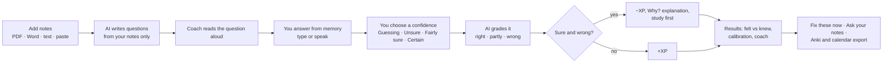
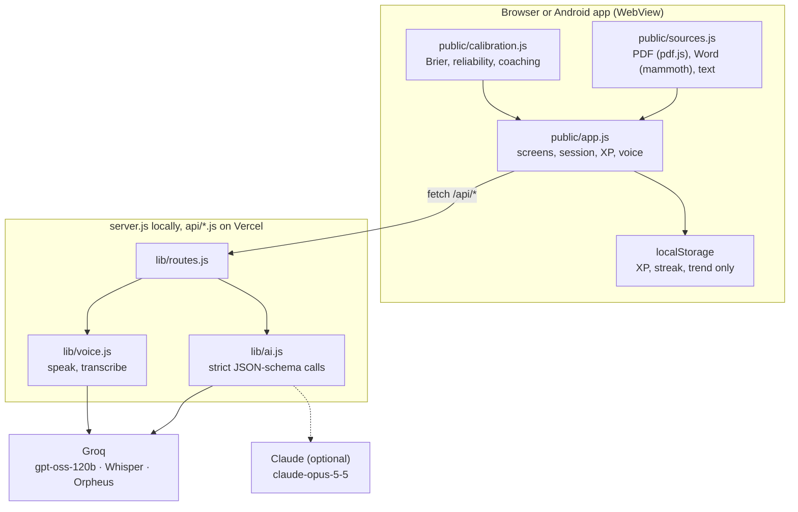
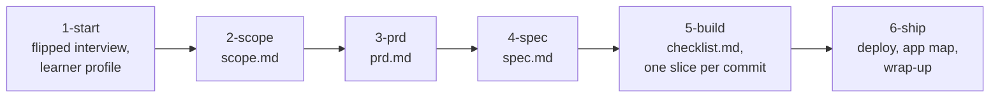

<p align="center">
  
</p>

<p align="center">
  <a href="https://recall-first.vercel.app"><b>Live site</b></a> ·
  <a href="https://recall-first.vercel.app/app"><b>Open the app</b></a> ·
  <a href="https://github.com/LSUDOKO/recall-first/releases/latest/download/recall-first.apk"><b>Android APK</b></a> ·
  <a href="devpost/scope.md">Scope</a> · <a href="devpost/prd.md">PRD</a> · <a href="devpost/spec.md">Spec</a>
 ·
  <a href="https://github.com/LSUDOKO/recall-first/releases/latest/download/recall-first-film.mp4">Demo video</a>
</p>

<p align="center">
  <a href="https://github.com/LSUDOKO/recall-first/releases/latest"></a>
  <a href="https://github.com/LSUDOKO/recall-first/pkgs/npm/recall-first"></a>
  <a href="LICENSE"></a>
  <a href="https://recall-first.vercel.app"></a>
  <a href="#built-for-build-with-ai-basics"></a>
</p>

## About

**Recall First is an AI study partner that shows you what you only *think* you know.**

You add your notes (PDF, Word, text, or pasted). The AI writes questions from those notes only. You answer
from memory, by typing or speaking, and you say how sure you are **before** you see the result. At the end,
Recall First puts what you *felt* you knew next to what you *actually* knew, and tells you exactly which
confident answers were wrong, so you know what to study first.

Most AI study tools make studying feel easier. Recall First measures whether your confidence is earned.

<p align="center">
  
</p>

---

## Contents

- [Why this exists](#why-this-exists)
- [How it is different](#how-it-is-different)
- [See it working](#see-it-working)
- [How it works](#how-it-works)
- [Features](#features)
- [The research behind it](#the-research-behind-it)
- [Run it](#run-it)
- [Architecture](#architecture)
- [Built for Build With AI: Basics](#built-for-build-with-ai-basics)
- [Project layout](#project-layout)
- [Credits and licence](#credits-and-licence)

## Why this exists

Asking an AI to summarise your notes feels like studying. The summary reads smoothly, so it feels familiar,
and that feeling of fluency gets mistaken for knowledge. Students stop studying too early, and the gaps show
up in the exam.

Two findings shaped this project:

- **Answering from memory beats rereading.** Practice testing outperforms restudying across 122 experiments.
- **Learners can't tell what they know without testing it.** Confidence judgments only become accurate after
  the learner gets direct evidence of what they can and can't recall.

So the app never explains first. You answer, you commit to a confidence level, and only then do you see the
result.

## How it is different

| | Quizlet | Gemini Notebook (NotebookLM) | ChatGPT Study Mode | Knowt | Anki | **Recall First** |
|---|---|---|---|---|---|---|
| Questions generated from your own files | Paid | Yes | Yes | Yes | No (add-ons) | **Yes, PDF, Word, text, paste** |
| Answer typed or **spoken** from memory, no multiple choice | Partly | Partly | Yes | Partly | Self-graded | **Yes, Whisper speech to text** |
| Confidence rated **before** each result | No | No | No | No | No | **Yes, four levels** |
| Score that punishes being sure and wrong | No | No | No | No | No | **Yes, certainty-based XP** |
| "Felt vs knew" calibration chart and Brier score | No | No | No | No | No | **Yes** |
| Catch a planted error in an AI summary | No | No | No | No | No | **Yes** |
| Second question, new angle, on each confident miss | No | No | No | No | No | **Yes (hypercorrection)** |
| Explanations only **after** you answer | No | No | Optional | No | n/a | **Always** |
| Account required | Yes | Yes | Yes | Yes | Optional | **No** |

Competitor features are taken from their public pages and a 2026 comparison of AI study tools. The point is
not that they are bad tools. They compete on generating content, shared libraries and scheduling. None of them
measures whether your confidence matches what you can actually recall, and that is the whole product here.

## See it working

### On Android

Screenshots of the Recall First APK running on Android 15 (1080 × 2400, Android emulator), against the live site
with real AI. These runs also caught two phone-only bugs that are now fixed: the page drawing under the status
bar on Android 15, and the keyboard popping up over each question.

<p align="center">
  
</p>

<table>
  <tr>
    <td align="center"><br><sub>Add notes as sources</sub></td>
    <td align="center"><br><sub>Each source is a switchable chip</sub></td>
    <td align="center"><br><sub>The coach asks, and reads it aloud</sub></td>
  </tr>
  <tr>
    <td align="center"><br><sub>Commit to a confidence: see the stakes</sub></td>
    <td align="center"><br><sub>Certain and wrong: −8 XP</sub></td>
    <td align="center"><br><sub>"Why?" names the mix-up, adds a memory hook</sub></td>
  </tr>
</table>

### How it works, in motion

<table>
  <tr>
    <td align="center" width="50%"><br><sub><b>Quiz:</b> sample notes → AI question → answer <b>by voice</b> (transcribed by Whisper) → Certain → "Wrong, −8 XP" → Why?</sub></td>
    <td align="center" width="50%"><br><sub><b>Results:</b> spot the false sentence → felt vs knew → calibration chart → AI coach → Ask your notes</sub></td>
  </tr>
</table>

### The results screen

<table>
  <tr>
    <td align="center"><br><sub>One sentence in this AI summary is false</sub></td>
    <td align="center"><br><sub>The gap between felt and knew</sub></td>
    <td align="center"><br><sub>Does each confidence level mean what it says?</sub></td>
  </tr>
  <tr>
    <td align="center"><br><sub>AI coach: the pattern and three next steps</sub></td>
    <td align="center"><br><sub>Ask your notes, with the line quoted</sub></td>
    <td align="center"><br><sub>Spoken answer, ready to edit</sub></td>
  </tr>
</table>

<sub>The results captures and GIFs were recorded in Chromium at phone size (390 × 844) against the live site. The
microphone input in the voice GIF is a synthesized voice clip played into a virtual microphone.</sub>

## How it works



1. **Add your notes.** Drop PDFs, Word files, text or Markdown, or paste. Text is extracted in the browser;
   files are never uploaded or stored.
2. **Pick a level.** Easy, Exam or Hard. Hard questions make you connect facts from different parts of the notes.
3. **Answer from memory.** The notes are hidden. Type, or tap the mic and speak.
4. **Say how sure you are, before the result.** The screen shows what is at stake: Certain earns +4 if right and
   costs −8 if wrong. "I don't know" costs nothing, because honesty is never the mistake.
5. **Get graded.** Paraphrases count. Half-answers get half credit. Wrong or hinted answers can ask "Why?".
6. **See the gap.** Felt vs knew, a calibration score, which confidence levels you can trust, and a coach with
   three next steps.
7. **Close the gap.** Fix the confident misses with a new question from a different angle, write the correction
   in your own words, ask your notes, and export what you missed for spaced review.

## Features

**Catch the illusion**
- **Confidence before every result**, four levels, with the stakes shown live.
- **Certainty-based XP.** Sure and right earns most, sure and wrong costs most, "I don't know" costs nothing.
- **Calibration chart and Brier score.** How often each confidence level was right, against what it claims.
- **Fluency traps.** Answered fast, marked Certain, and wrong.
- **Spot the false sentence.** An AI summary of your notes with one planted error.

**Close the gap**
- **Fix these now.** A second question on each confident miss, from a new angle.
- **Why? Explain it.** After a miss, the explanation from your notes plus a memory hook.
- **Teach the gap.** Write the correction in your own words; it is graded against your notes.
- **Hint ladder.** Three hints, weakest first; a right answer after a hint counts half.
- **Blind-spot map.** Which concepts in your notes were right, missed, sure but wrong, or untested.
- **AI coach.** Names the pattern in your run and gives three concrete next steps.

**Make it stick**
- **Guess first.** Quiz before you read, read, then quiz again with new questions.
- **Mix sources.** Questions spread across several files.
- **Spaced return.** Export missed questions to Anki, or add 1, 3 and 7-day calendar reminders.
- **Streak and XP**, kept only in your browser.
- **Share the shape, not the notes.** A Wordle-style card with no content in it.

**Voice and AI**
- **Read aloud.** Questions, feedback, explanations and coach messages are spoken.
- **Answer by voice.** Recorded, transcribed by Groq Whisper, put in the answer box for you to check. Never
  submitted on its own.
- **Ask your notes.** After the quiz only. Answers come only from your notes, with the supporting line quoted
  word for word; questions your notes can't answer are refused.
- **Question-quality check** endpoint flags questions whose answer isn't in the notes.

## The research behind it

Found with academic search (Consensus, SciSpace). Recall First applies these findings; it does not claim to
prove learning gains on its own.

| Finding | Source | Where it shows up |
|---|---|---|
| Practice testing beats rereading, and transfers to new questions (122 experiments, d ≈ 0.40) | [Pan & Rickard, 2018, *Psychological Bulletin*](https://consensus.app/papers/details/c5cee08032d85fd58244269b72d268a6/) | The whole loop |
| Recall tests help more than recognition tests | [Rowland, 2014, *Psychological Bulletin*](https://consensus.app/papers/details/04c7eb0ad2bf5eb6b122f94da91c5edb/) | Typed or spoken answers, no multiple choice |
| After retrieval practice, confidence judgments become more accurate | [Barenberg & Dutke, 2018, *Memory*](https://consensus.app/papers/details/262f1aaf7ac8598aab45e0a38197ce55/) | Confidence before every result |
| Feedback on both performance and judgments reduces overconfidence | [Callender et al., 2016, *Metacognition and Learning*](https://consensus.app/papers/details/0f2c047021dc5384a1bd2a4d914db895/) | Calibration chart and coaching line |
| Errors made with high confidence are the easiest to correct after feedback | [Butterfield & Metcalfe, 2001](https://consensus.app/papers/details/ec26368ccc7a5a9085c3791e95c4a06e/); [Carpenter et al., 2018](https://consensus.app/papers/details/22663195ea795b9f92b7b07ca6c7c00d/) | Study these first, Fix these now |
| …but they come back after a week unless re-tested | [Butler, Fazio & Marsh, 2011](https://consensus.app/papers/details/f970030e32b2586da064f23681499545/) | Calendar reminders; week-later re-test in the roadmap |
| Pretesting before studying improves learning; learners underestimate it | [Pan et al., 2023](https://consensus.app/papers/details/8d88a6d146c65df182d1bcda7966b8f3/); [Pan et al., 2021](https://consensus.app/papers/details/c267028722955f0197e1c86a0e2cb7d3/) | Guess first mode |
| Successive relearning (retrieve until correct, over spaced days) improves exams and retention | [Rawson et al., 2013](https://consensus.app/papers/details/cdd40e197aaf5d2bb97c22a508f4e323/); [Higham et al., 2021](https://consensus.app/papers/details/451ef4da8f0c5561ab8a5de27bcdfa48/) | Spaced return; relearning decks in the roadmap |
| Interleaving helps for confusable topics, less for word lists | [Brunmair et al., 2019, meta-analysis](https://consensus.app/papers/details/621345c33c1c5d6ab95c10b54896bbb1/) | Mixed sources |
| Self-explanation beats elaborative interrogation | [O'Reilly et al., 1998](https://consensus.app/papers/details/ef07e1489de655d8831053986c588f60/) | Teach the gap |
| Students with free AI answers did worse once it was removed; hints reduced the harm | [Bastani et al., 2025, *PNAS*](https://doi.org/10.1073/pnas.2422633122) | No explanations before answering, hint ladder |

**Honest limits.** The testing effect is weaker and less certain in maths
([Murray et al., 2025](https://consensus.app/papers/details/d58ba8eb9b445dd589188b23ba45a35d/)), so Recall First
fits fact- and concept-heavy notes best. Training calibration with a scoring rule alone has had null results
([Martin et al., 2024](https://consensus.app/papers/details/c68a967f82b45e5d8149c730069b1409/)), which is why
the app pairs the score with per-level feedback and a concrete next step rather than a number alone.

## Run it

**Try it now:** [recall-first.vercel.app/app](https://recall-first.vercel.app/app). Press *Try sample notes* if you
don't have notes handy. On Android, install the [APK](https://github.com/LSUDOKO/recall-first/releases/latest/download/recall-first.apk)
and allow the install when asked.

**Run it locally** (Node.js 22 or newer, and a free Groq key or an Anthropic key):

```bash
git clone https://github.com/LSUDOKO/recall-first.git
cd recall-first
npm install
cp .env.example .env        # paste your key after GROQ_API_KEY= (or ANTHROPIC_API_KEY=)
npm start                   # http://localhost:3000 (landing) and /app (the quiz)
```

**Or install the package** from [GitHub Packages](https://github.com/LSUDOKO/recall-first/pkgs/npm/recall-first).
GitHub's npm registry needs a GitHub token with `read:packages`, even for public packages:

```bash
echo "@lsudoko:registry=https://npm.pkg.github.com" >> ~/.npmrc
echo "//npm.pkg.github.com/:_authToken=$(gh auth token)" >> ~/.npmrc
GROQ_API_KEY=your-key npx @lsudoko/recall-first     # http://localhost:3000
```

| Command | What it does |
|---|---|
| `npm start` | Local server with live AI |
| `RECALL_MOCK=1 npm start` | Practice mode: canned questions and a word-overlap grader, no key needed |
| `npm test` | 23 tests: score, XP, calibration, scheduling, interleaving, share codec |
| `android/build.sh` | Rebuilds `dist/recall-first.apk` with the Android SDK build-tools (no Gradle) |

**Deploy:** the repo deploys to Vercel as-is (`public/` static, `api/*.js` functions). Set `GROQ_API_KEY` (or
`ANTHROPIC_API_KEY`) in the project's environment variables. Optional: `RECALL_MODEL`, `RECALL_TTS_VOICE`.

**Read aloud with Groq's voice:** Groq's Orpheus voice model needs a one-time terms acceptance by the Groq org
owner at `console.groq.com/playground?model=canopylabs%2Forpheus-v1-english`. Until then the browser's built-in
voice is used automatically.

## Architecture



- **One API, two hosts.** `lib/routes.js` holds every handler; `server.js` serves them locally and `api/*.js`
  wraps them as Vercel functions.
- **Structured output everywhere.** Every model call sends a strict JSON schema and the reply is validated again
  on the server before the page sees it.
- **Keys stay on the server.** The browser never sees an API key.
- **No database, no accounts.** Notes travel in the request and nowhere else. XP, streak and the felt/knew
  trend live only in the learner's browser.

| Route | Purpose |
|---|---|
| `POST /api/questions` | Five questions, concepts, hints and a summary with one planted error (difficulty: easy, exam, hard) |
| `POST /api/grade` | right, partly or wrong, with feedback and the correct answer |
| `POST /api/followups` | A new-angle question for each confident miss |
| `POST /api/explain` | Why the answer is right, plus a memory hook (after answering only) |
| `POST /api/coach` | The pattern in this run and three next steps |
| `POST /api/ask` | Answers from the notes with a verbatim quote, or a refusal |
| `POST /api/review` | Flags questions not answerable from the notes |
| `POST /api/speak` | Text to speech (Groq Orpheus), browser fallback |
| `POST /api/transcribe` | Speech to text (Groq Whisper) |
| `GET /api/status` | Provider, model and voice availability |

## Built for Build With AI: Basics

This project was built for the Devpost learning hackathon
[Build With AI: Basics](https://devpost.com), using the
[Devpost Learn skill pack](https://github.com/challengepost/learn-ai-basics). The main requirement is to design
and build with the skill pack, using flipped interaction and planning documents. Everything below can be
checked in this repository.

<p align="center">
  
</p>

### How the skill pack was used



| Skill | What it did | Proof in this repo |
|---|---|---|
| `1-start` | Introduced flipped interaction: the AI interviews the learner, the learner brings the idea and makes the decisions. Wrote the learner profile every later skill reads. | Skill at [`.claude/skills/1-start`](.claude/skills/1-start). The profile is kept out of git on purpose, as the skill requires: see the `/devpost/learner-profile.md` rule in [`.gitignore`](.gitignore). |
| `2-scope` | Turned the idea into one kernel and one core loop, with what is in and out of the proof of concept. | [`devpost/scope.md`](devpost/scope.md), `status: approved` |
| `3-prd` | Product requirements: the user journey, every screen, edge cases, look and feel, each traced back to the scope. | [`devpost/prd.md`](devpost/prd.md), `status: approved` |
| `4-spec` | Technical spec in plain language: server, API routes, AI calls with JSON schemas, file structure. | [`devpost/spec.md`](devpost/spec.md), `status: approved` |
| `5-build` | Split the build into small slices. Each slice has a "why now", PRD and spec references, a mechanical verify step and a commit message, and was ticked only after it passed. | [`devpost/checklist.md`](devpost/checklist.md), `status: approved`, slices 1–8 ticked |
| `6-ship` | Deployment, a code tour that maps the code back to the plan, and the wrap-up record. | [`devpost/app-map.html`](devpost/app-map.html), live at [recall-first.vercel.app](https://recall-first.vercel.app) |

### The planning documents

| Scope | Build checklist |
|---|---|
|  |  |
| **Product requirements (PRD)** | **Technical spec** |
|  |  |

### The plan, slice by slice, in the commit history

The proof of concept was built exactly in the checklist's order, one commit per slice:

| Checklist slice | Commit |
|---|---|
| Empty repository with a licence | `04451e5` Initial commit |
| 1. Paste notes; the page says when there is enough to quiz on | `960a7b1` Add Start screen with note intake and server |
| 2. Quiz me turns your notes into five real questions | `04b0c9b` Generate five questions from notes with structured output |
| 3–4. Answer from memory, rate confidence, graded fairly | `3edc47c` Add answer, confidence picker, I don't know flow and grading |
| 5. Results show where confidence and knowledge disagree | `2719b18` Add results with calibration scale and study-first list |
| 6. Errors, edge cases, README and polish | `be45e0c` Handle errors and edge cases, add README |
| Ship: code tour and wrap-up | `5753229` Add app map and build wrap-up records |
| 7. Expansion features | `e07a272` Add hints, calibration scoring, spot-the-error, fix round and exports |
| 8. Deployed on Vercel | `130b817` Deploy to Vercel |

### Changes of plan are written down, not hidden

Every change after approval is recorded under **Revisions** in [`devpost/checklist.md`](devpost/checklist.md),
with the reason and the documents it touched. Examples: the look changed twice, slices 3 and 4 were merged,
Groq was added as a provider, and voice and the AI tutor came after the proof of concept. Work beyond the
original scope is kept as a separate *Expansion After the Proof of Concept* section in the PRD, so the approved
plan stays readable.

### Submission checklist

| Requirement | Where |
|---|---|
| New project, started from an empty folder during the submission period | First commit `04451e5` is an empty repo with a licence |
| Built with the skills (`1-start` → `6-ship`) | [`.claude/skills/`](.claude/skills) and their outputs in [`devpost/`](devpost) |
| Planning docs in the repo | Scope, PRD, spec and checklist, all `status: approved` |
| Open source licence | [MIT](LICENSE) |
| Public repository | You are here |
| Demo video (1–3 minutes) | [recall-first-film.mp4](https://github.com/LSUDOKO/recall-first/releases/latest/download/recall-first-film.mp4) (2:54, in the latest release) |
| Working app | [recall-first.vercel.app](https://recall-first.vercel.app) and the [Android APK](https://github.com/LSUDOKO/recall-first/releases/latest/download/recall-first.apk) |

## Project layout

```
server.js              local server: static files + /api/*
api/                   Vercel functions, one per route
lib/ai.js              question, grade, follow-up, explain, coach, ask, review (Groq or Claude)
lib/voice.js           Groq Orpheus text to speech, Groq Whisper speech to text
lib/routes.js          the API handlers, shared by both hosts
lib/vercel.js          wraps a handler as a Vercel function
public/index.html      landing page
public/app.html        the quiz
public/app.js          session, screens, XP, voice, results
public/sources.js      PDF, Word and text extraction in the browser
public/calibration.js  Brier score, per-level reliability, coaching line
public/store.js        browser-only decks, relearning schedule, share codec (roadmap)
public/styles.css      design tokens and components
public/media/          logo, banner, screenshots and GIFs used in this README
android/               WebView wrapper and a Gradle-free build script
dist/recall-first.apk  signed debug build
test/                  node --test suites
devpost/               scope, PRD, spec, checklist, app map
samples/               example notes
```

## Roadmap

Already written and tested, not yet wired into the screens: successive relearning decks with a due-today list
(equal spacing, retire after three spaced correct answers), a week-later re-test of fixed mistakes, interleaved
decks across subjects, share-a-deck by link, and backup and restore. See `public/store.js` and
`test/store.test.js`.

## Credits and licence

- Mascot artwork and the cobalt colour system come from the author's earlier project
  [Tally](https://github.com/LSUDOKO) (same author, MIT).
- AI by [Groq](https://groq.com) (`openai/gpt-oss-120b`, `whisper-large-v3-turbo`,
  `canopylabs/orpheus-v1-english`), with [Claude](https://www.anthropic.com) supported as an alternative.
- PDF reading by [pdf.js](https://mozilla.github.io/pdf.js/); Word reading by [mammoth](https://github.com/mwilliamson/mammoth.js).
- Fonts: Inter Tight and JetBrains Mono (Google Fonts).

MIT licence. See [LICENSE](LICENSE).
